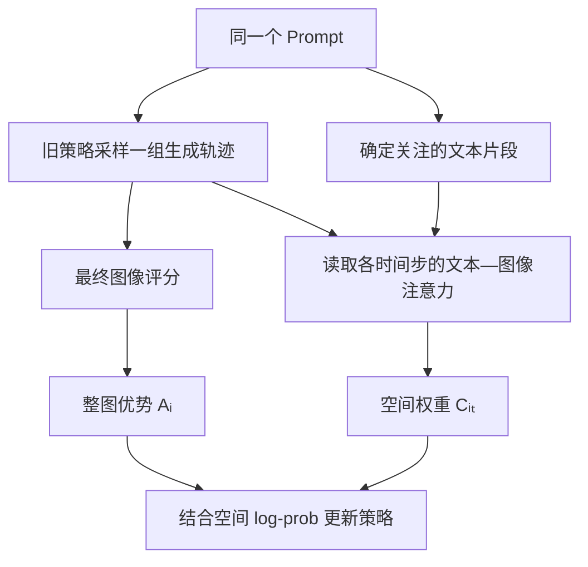

# STAR：用户认可的完整讲解示例

确认日期：2026-10-31。以下保留用户认可回答的结构、详略、流程图与公式讲法，已将会话专属本地文件引用替换为公开原文链接。论文事实、数值及研究分析仅属于该例，不能用作其他论文的默认结论。正式要求见 [output-standard.md](output-standard.md)，排版按当前宿主能力适配。

---

**STAR 的核心是：利用生成模型内部的文本—图像注意力，把整张图的优势信号，动态分配给不同生成步骤中的不同空间位置。**

我按你之前常用的 **Insight & Motivation → Method → Experiments → Limitations → 对你研究的启发** 来讲，方法部分重点解释公式与实际更新过程。

论文：[STAR: SpatioTemporal Adaptive Reward Allocation for Text-to-Image RL Post-Training](https://arxiv.org/abs/2606.17979)。首次提交于 **2026 年 6 月 16 日**，以下依据 **6 月 18 日的 v2**。原文未列出会议、作者单位或官方代码链接。它属于你思维导图中的“**通用偏好对齐 → 空间细粒度**”，实验任务是文生图。

---

**一、Insight & Motivation：整张图表现好，不代表每个区域都值得同样奖励**

先回顾 Flow-GRPO 的基本过程：

1. 对同一个 Prompt 生成一组图像。
2. 给每张最终图像打分。
3. 根据组内比较，计算每张图对应的优势 \(A_i\)。
4. 用这个优势更新该图像的生成轨迹。

问题在于，**奖励是整图级的，但生成过程同时具有时间结构与空间结构。**

以论文图 1 的提示词为例：一把红色椅子旁边有一株绿色植物。

决定文本对齐的关键，是椅子、植物及其颜色和关系。墙壁、地板等区域也影响图像质量，但它们对这个提示词的关键语义贡献不同。

标准方法给整条轨迹共享一个 \(A_i\)，缺少明确机制去强调相关位置。这里的“共享优势”并不意味着各位置实际梯度相同，只是**没有另外提供空间分配权重**。

STAR 的观察是：

**生成模型在处理提示词时，本来就在计算“哪些图像位置与哪些文本 Token 发生交互”。这些注意力可以用来指导优势信号的分配。**

而且，这些注意力会随着去噪过程变化。因此，同一张图在不同时间步可以使用不同的空间权重。[原文 Introduction 与图 1](https://arxiv.org/html/2606.17979v2)

---

**二、Method：从整图优势，到时变空间权重，再到空间梯度更新**

先把训练流程拆成两条支路：

左边回答“**这张图相对同组其他图好不好**”，右边回答“**哪些位置与提示词更相关，应当加强更新**”。

这两个问题要分开理解。

**① 先计算每张图的整图优势**

沿用熟悉的 GRPO 写法，可以写成：

\[
A_i=
\frac{R_i-\mu_R}{\sigma_R+\epsilon}.
\]

其中：

- \(R_i\)：第 \(i\) 张图的最终奖励。
- \(\mu_R,\sigma_R\)：同一个 Prompt 下，一组图像奖励的均值和标准差。
- \(\epsilon\)：防止分母为零的小常数。

\(A_i>0\) 表示这张图高于组内平均水平；\(A_i<0\) 表示低于平均水平。

STAR 的外部评分来源随任务变化：

| 任务 | 评分依据 |
|---|---|
| GenEval | 官方规则评估流程，检查物体、数量、颜色、位置等 |
| OCR 文字生成 | 识别文字与目标文字之间的编辑距离 |
| PickScore | 学习得到的图文偏好评分模型 |

**注意力负责分配更新强度，图像好坏仍由外部奖励判断。** 所以，STAR 可以搭配不可微的规则奖励。[原文 §4.1](https://arxiv.org/html/2606.17979v2)

**② 找到提示词中需要关注的文本片段**

正文用一组文本单元表示提示词中的关键内容：

\[
\mathcal K(c)=\{q_1,\ldots,q_K\}.
\]

例如，主体、颜色、数量、风格和空间关系等。

但附录中的实际实现比这个概念描述更简单：

| 任务 | 文本单元如何获得 |
|---|---|
| GenEval | 去掉 “a photo of”等模板前缀，剩余整段作为一个单元 |
| PickScore | 默认同样采用上述规则；另比较了组件拆分方案 |
| OCR | 使用提取提示，获取目标文字、文字载体及其他可定位内容 |

因此，GenEval 中：

“a photo of a yellow bus and an orange handbag”

默认变成：

\[
\mathcal K(c)=
\{\text{a yellow bus and an orange handbag}\}.
\]

**并不是一定要先用大模型拆成“黄色公交车”“橙色手提包”两个独立组件。**

这一点影响你对方法复杂度和新增成本的判断。附录也没有明确给出 OCR 提取所用模型的具体名称。[原文附录 A](https://arxiv.org/html/2606.17979v2)

**③ 从注意力构建每一步的空间热图**

对于第 \(i\) 条生成轨迹、第 \(t\) 个时间步，作者读取文本—图像注意力：

\[
\alpha_t^{i,\ell}(u,j).
\]

这里：

- \(u\)：图像潜空间中的一个位置。
- \(j\)：一个文本 Token。
- \(\ell\)：选中的 Transformer 层。

它表示当前图像位置与该文本 Token 的注意力联系。

SD3.5 使用联合注意力，STAR 取其中 **image query → text key** 的部分。作者从多个选中层里取最大值：

\[
\alpha_t^i(u,j)
=
\max_{\ell\in\mathcal L}
\alpha_t^{i,\ell}(u,j).
\]

如果文本单元 \(q_k\) 对应的 Token 集合是 \(\mathcal T_k\)，就先对这些 Token 求平均：

\[
M_t^{i,k}(u)
=
\frac{1}{|\mathcal T_k|}
\sum_{j\in\mathcal T_k}
\alpha_t^i(u,j).
\]

再对全部文本单元求平均：

\[
H_t^i(u)
=
\frac{1}{K}\sum_{k=1}^K M_t^{i,k}(u).
\]

可以把这个过程理解成：

**先看一个位置与每个关注短语联系多强，再汇总成一张“提示词相关程度图”。**

如果默认只有一个文本单元，最后这次平均自然就不需要合并多个组件。

需要注意：热图高说明该位置与所选文本交互较强，**并不直接说明这个位置生成正确，也不证明它对奖励具有更大的因果贡献**。[原文 §3.1，公式（3）—（8）](https://arxiv.org/html/2606.17979v2)

**④ 把热图变成有界的空间权重**

热图的原始数值不适合直接乘到优势上，作者先做 min–max 变换：

\[
C_t^i(u)
=
1+(\lambda-1)
\frac{
H_t^i(u)-\min_v H_t^i(v)
}{
\max_v H_t^i(v)-\min_v H_t^i(v)+\epsilon
}.
\]

其中，\(\lambda\geq1\) 控制增强强度，实验采用 \(\lambda=1.5\)。

忽略数值稳定项，可以理解为：

\[
1\leq C_t^i(u)\leq1.5.
\]

例如，三个位置的热度分别为 \(0.1、0.3、0.5\)，对应权重就是：

\[
1.0,\quad1.25,\quad1.5.
\]

这意味着：

- 相关程度最低的位置，保留基础更新强度。
- 相关程度最高的位置，更新权重最多提高到 1.5 倍。
- 背景不会被直接置零。

随后得到空间优势：

\[
\boxed{A_t^i(u)=A_iC_t^i(u)}.
\]

这里有个必须记住的性质：**所有位置都继承同一个 \(A_i\) 的正负号。**

例如，若 \(A_i=-1\)，三个位置得到的是：

\[
-1,\quad-1.25,\quad-1.5.
\]

所以 STAR 能决定“哪里加强奖励或惩罚”，但不能在一张总体较差的图中，自动做到“奖励画对的植物，同时惩罚画错的椅子”。它没有得到独立的局部好坏标签。[原文公式（9）—（10）](https://arxiv.org/html/2606.17979v2)

**⑤ “Temporal”体现在哪里？**

因为每一步都重新获得注意力，所以：

\[
C_{t_1}^i(u)\neq C_{t_2}^i(u)
\]

是可能的。不同轨迹之间的权重也可以不同。

因此，STAR 实现的是**随时间变化的空间分配**。它没有单独估计“第 3 步比第 8 步贡献更大”的动作价值，也没有给不同步骤产生独立的正负优势。

更精确的理解是：**同一个终局优势，由每一步自己的空间热图来调节。**

**⑥ 最关键的公式（12）：数值共享标量 ratio，梯度落实到空间位置**

你之前关注过“是否需要把 Log-Likelihood 拆到 Token 级”。STAR 同样需要保留空间位置的 log-prob：

\[
\ell_{\theta,t}^i(u).
\]

作者把它在空间上取平均：

\[
\bar\ell_{\theta,t}^i
=
\frac{1}{|\Omega_t|}
\sum_{u\in\Omega_t}\ell_{\theta,t}^i(u).
\]

再定义论文所用的标量 ratio：

\[
\bar r_{\theta,t}^i
=
\exp\left(
\bar\ell_{\theta,t}^i-\bar\ell_{\mathrm{old},t}^i
\right).
\]

其中，old 表示采样时保存的旧策略，而不是 KL 正则里的冻结参考模型。

STAR 的空间 ratio 是：

\[
\boxed{
\rho_{\theta,t}^i(u)
=
\operatorname{sg}\!\left[\bar r_{\theta,t}^i\right]
\frac{\exp(\ell_{\theta,t}^i(u))}
{\operatorname{sg}[\exp(\ell_{\theta,t}^i(u))]}
}
\]

\(\operatorname{sg}\) 表示 stop-gradient：前向保留数值，反向不传梯度。

这条公式要分两个层面看。

**前向计算时：**

分子与分母数值相同，因此：

\[
\rho_{\theta,t}^i(u)=\bar r_{\theta,t}^i.
\]

也就是说，同一个时间步中，各位置的 ratio **数值相同**。

**反向传播时：**

分母及前面的标量 ratio 都停止梯度，得到：

\[
\nabla_\theta\rho_{\theta,t}^i(u)
=
\bar r_{\theta,t}^i
\nabla_\theta\ell_{\theta,t}^i(u).
\]

因此，每个位置的梯度仍然能单独计算，再由对应的空间优势加权。

这与直接使用

\[
\exp\big(\ell_\theta(u)-\ell_{\mathrm{old}}(u)\big)
\]

构造独立的局部新旧概率比，具有不同的行为。

**STAR 保留了标量 ratio 的数值尺度，同时把梯度分配到空间位置。**[原文 §3.2，公式（11）—（12）](https://arxiv.org/html/2606.17979v2)

**⑦ 最终目标：空间加权的 clipped objective，加上 KL 约束**

作者最大化：

\[
\begin{aligned}
\mathcal J_{\mathrm{STAR}}(\theta)
=
\mathbb E\Bigg[
\frac1T\sum_t
\frac1{|\Omega_t|}\sum_u
\min\Big(
&\rho_{\theta,t}^i(u)A_t^i(u),\\
&\operatorname{clip}
(\rho_{\theta,t}^i(u),1-\varepsilon,1+\varepsilon)
A_t^i(u)
\Big)
\Bigg]
-\beta D_{\mathrm{KL}}.
\end{aligned}
\]

其中：

- \(\varepsilon\)：控制 ratio 的裁剪范围。
- \(\beta\)：控制偏离冻结参考策略的代价。
- 对空间和时间求平均，汇总整条轨迹的训练信号。

把 rollout 记录的权重视为固定量，在没有触发裁剪的部分，可以推导出：

\[
\nabla_\theta\mathcal J_{i,t}
=
\frac{A_i\bar r_{\theta,t}^i}{|\Omega_t|}
\sum_u
C_t^i(u)\nabla_\theta\ell_{\theta,t}^i(u).
\]

这条**由原文公式推导得到的表达式**最直接地展示了 STAR 在做什么：相关位置的 log-prob 梯度，被乘上更大的 \(C_t^i(u)\)。

还有一个细节：由于各位置的 ratio 数值相同、优势符号相同，**不能把它理解成每个位置根据独立的局部 ratio 各自触发裁剪。**

与你读过的 SGA 对照：

| 方法 | 空间权重来源 | Ratio 的处理 |
|---|---|---|
| Flow-GRPO | 使用整图优势 | 时间步级标量 ratio |
| STAR | 各时间步的文本—图像注意力 | 标量 ratio 数值尺度＋空间梯度 |
| SGA-Flow-GRPO | 奖励梯度及其后处理 | 各 Token 独立计算局部 ratio |

[STAR 方法原文](https://arxiv.org/html/2606.17979v2)、[SGA 方法原文](https://arxiv.org/html/2609.32340)

---

**三、Experiments：效果有提升，但证据支持的范围需要分清**

作者在 **SD3.5 Medium＋Flow-GRPO** 上实现 STAR，使用 LoRA 更新：

| 配置 | 设置 |
|---|---|
| 训练采样步数／评估步数 | 10／40 |
| 图像分辨率 | \(512\times512\) |
| 每个 Prompt 的组大小 | 24 |
| SDE 噪声参数 | 0.7 |
| LoRA rank／scaling | 32／64 |
| 注意力层 | Transformer blocks 10—15 |
| 分配强度 | \(\lambda=1.5\) |
| KL 系数 | GenEval、OCR 为 0.04；PickScore 为 0.01 |

主结果如下：

| 指标 | Flow-GRPO | ＋STAR | 绝对变化 |
|---|---:|---:|---:|
| GenEval | 0.9500 | **0.9759** | ＋0.0259 |
| OCR | 0.9200 | **0.9757** | ＋0.0557 |
| PickScore | 23.31 | **23.60** | ＋0.29 |

这些是三个任务设置下各自报告的成绩，不能据此认定一个模型检查点同时达到三项结果。OCR 的图中标签是 “Acc.”，正文描述了编辑距离奖励，但没有给出完整的指标计算细节，因此不宜直接解释为“97.57% 的图中文字全部正确”。[原文 §4.1—4.2、图 2](https://arxiv.org/html/2606.17979v2)

GenEval 子任务中，最值得关注的是：

- **属性绑定：0.86 → 0.94**。
- 颜色：0.92 → 0.96。
- 数量：0.95 → 0.98。
- 双物体：0.99 → 1.00。
- **位置关系：0.99 → 0.98，略有下降。**

属性绑定的提升与“强调提示词相关区域”的设计动机一致。但这些结果尚不能单独证明，收益一定来自更准确的信用估计，也不能说所有子任务都提升了。[原文表 1](https://arxiv.org/html/2606.17979v2)

消融实验主要回答了两个实现问题。

第一，**先合成一张热图，还是分别处理每个组件？**

图 3(a) 中，两条训练曲线非常接近。复杂的组件级处理没有显示出额外收益，因此作者选择更简单的共享热图。它说明本文设置下简单聚合已经够用；没有证明复杂提示词永远不需要组件级分配。

第二，**读取哪些注意力层？**

作者比较前层、中层、后层与全部层。第 10—15 层表现接近全部层，因此选中间这组层，以减少需要读取的注意力。

作者另外报告，STAR 新增训练时间 **低于 2%**，峰值显存增加 **1.56%**。这是相对于 Flow-GRPO 的增量开销；论文没有充分展开硬件、绝对耗时及测量协议。[原文 §4.3、图 3](https://arxiv.org/html/2606.17979v2)

定性图 4 中，后训练结果通常更丰富、场景表现更强。但其比较对象是**原始 SD3.5-M 与 Flow-GRPO＋STAR**，缺少单独的 Flow-GRPO 图像。因此，这张图展示了整体后训练效果，无法单独分离 STAR 的贡献。

---

**四、Limitations：哪些问题还没有解决？**

原文没有独立的局限性章节。下面是基于公式与实验的分析。

**首先，注意力相关性与奖励贡献之间存在距离。**

注意力高，说明模型在关联该文本与该位置；它不能保证那里画对了，也不能保证改动那里就能提高奖励。

特别是模型漏画某个物体时，注意力能否准确指出“应该出现但尚未出现的位置”，论文没有专门验证。

**其次，局部更新仍继承整图评价的方向。**

一张图中可能椅子错误、植物正确。只要整图优势为负，两个相关区域都会获得负优势，仅有强度差异。

因此，STAR 更适合被理解为**语义相关程度引导的训练分配**，还没有解决局部正确与局部错误混杂的问题。

**第三，时间动态的独立贡献没有被充分验证。**

论文缺少这些关键对照：

- 用最终一步的空间图，固定指导所有时间步。
- 将各步空间图平均，再指导所有时间步。
- 使用每一步自己的空间图。
- 打乱空间图与时间步的对应关系。

缺少这些比较，就难以判断动态变化比固定空间加权具体多贡献了多少。

**第四，分配与整体更新强度的影响尚未分离。**

它的权重位于 \([1,1.5]\)，没有要求空间均值为 1。因此平均更新权重通常也会提高。

一个有辨别力的对照是：**把所有位置统一乘上相同的平均系数，观察是否也能获得类似收益。**

如果均匀放大就能复现大部分提升，空间分配本身的贡献就需要重新衡量。

**第五，泛化与复现证据有限。**

正文讨论了其他注意力架构的接入方式，但实际实验只展示 SD3.5-M。文中也没有充分报告多随机种子误差、人工偏好评测，以及完整的优化器、学习率、数据规模等复现信息。

所以，目前最稳妥的结论是：**它在作者报告的 SD3.5-M 实验设置下有效，跨模型和更广任务的效果仍需验证。**

---

**五、对你研究的启发：把“分配强度”与“判断局部好坏”分开**

STAR 最值得借鉴的，是它将两个角色分开：

**外部奖励判断结果质量，模型内部信号决定训练重点。**

这给空间细粒度对齐提供了一条成本较低的路径：先使用现有整图奖励，再研究怎样利用生成过程自身的结构改善更新。

但对于你关注的安全对齐，直接沿用还有一个缺口：**与提示词高度相关的区域，不一定就是风险来源。**

例如，整张图因为一个小区域不安全而得低分，如果注意力主要强调人物主体，就可能同时抑制需要保留的正常内容。相反，风险来自模型自行补出的背景元素时，关注提示词主体又可能漏掉真正的问题区域。

以下是延伸设想，并非论文已经验证的结论：

| 可以研究的问题 | 最小验证方式 |
|---|---|
| 随时间变化的空间权重是否必要？ | 比较动态图、固定图、时间平均图与打乱时间图，并匹配平均更新强度 |
| 语义相关区域是否等于安全风险区域？ | 比较文本注意力图与局部风险定位图，同时测安全性、正常语义保留和图像质量 |
| 能否分别保护正确区域、修正错误区域？ | 在一张图同时包含正确与错误属性的任务上，引入组件级评价，检查是否减少连带破坏 |

其中，**“动态分配究竟比固定分配多解决了什么”**是最适合先验证的问题：它直接对应 STAR 的时间维度主张，也能帮助你判断后续方法应当补充时间贡献估计、局部好坏判断，还是更可靠的风险定位。

核对使用的全文与附录：  
[arXiv v2 PDF](https://arxiv.org/pdf/2606.17979v2)
